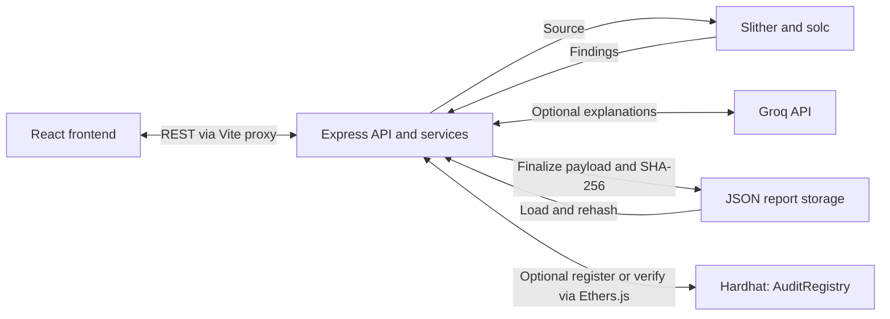
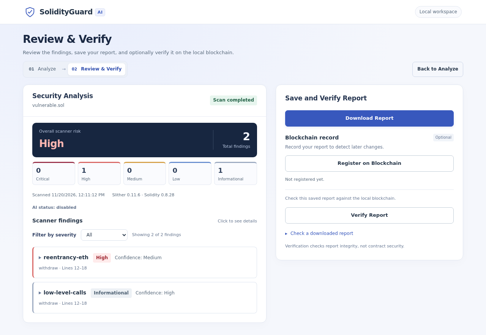
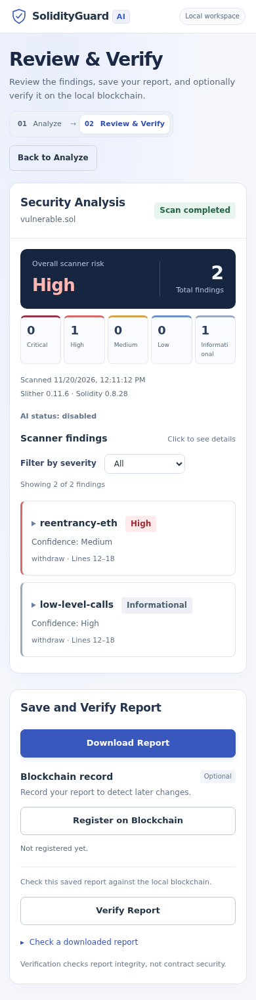

# SolidityGuard AI

Review Solidity contracts with Slither, optional Groq explanations and local blockchain
report verification. Built with React, Node.js, Express and Solidity.

## Key features

- Paste Solidity, upload a `.sol` file, or use a sample contract.
- Review scanner severity, confidence, descriptions and source locations.
- Optionally request AI explanations without changing scanner findings.
- Download a JSON report whose payload is finalized before hashing.
- Register its SHA-256 hash and verify saved or downloaded reports on-chain.

**No findings detected does not establish contract security.** Blockchain verification
checks report integrity, not contract safety or authorship. AI advice requires review.

## Architecture



AI receives bounded scanner findings and snippets. Reports are saved before optional
blockchain registration; [architecture details](docs/architecture.md) explain the sequence.

## Requirements

- Linux x86_64 or WSL2 x86_64; native Windows and macOS setup are unsupported.
- Node.js 24, npm 11, Python 3.12 with venv support, bash, curl and sha256sum.
- Internet for installation and optional Groq requests; scanning and blockchain run locally.

Slither 0.11.6 uses Python; Solidity 0.8.28 compiles source. Python is not an application backend.
Versions are pinned in the [lockfile](package-lock.json) and [Python requirements](requirements-slither.txt).

## Installation

Run from the project root:
```bash
npm run setup:local
```

Setup installs locked dependencies and the verified compiler, recreates `.venv`,
and checks scanner tooling. Install Python 3.12 first; set `PYTHON_BIN` to its
executable if needed. Existing `.venv` is preserved as `.venv.backup-...` and an
existing `backend/.env` is not overwritten. Remove backups only after setup succeeds.

Do not copy `.venv`, `node_modules`, `.tools`, or deployment state between machines.
Recreate them at the destination. For scanner-only preflight:

```bash
npm run doctor -- --scanner-only
```

## Start locally — three terminals

Run each terminal from the project root. Keep the blockchain and both servers running.

**Terminal 1 — blockchain**

```bash
npm run chain
```

**Terminal 2 — deploy for this chain session, check setup, then start the backend**

```bash
npm run deploy:local
npm run doctor
npm run dev:backend
```

**Terminal 3 — frontend**

```bash
npm run dev:frontend
```

Open **http://127.0.0.1:5173**. The API uses port **3001**; Hardhat uses port
**8545**, chain ID **31337**. No MetaMask is required.

Vite proxies `/api` to `http://127.0.0.1:3001`. Changing backend `PORT` also requires
updating [Vite's proxy](frontend/vite.config.js); browser tests assume ports 3001/5173.
Restarting/resetting Hardhat can erase registrations: redeploy and register reports again.

## Optional AI configuration

Setup creates `backend/.env` from the [template](backend/.env.example) if absent.
Keep credentials there, never in browser code, `VITE_*` variables or shared files.

```dotenv
PORT=3001
BLOCKCHAIN_RPC_URL=http://127.0.0.1:8545
BLOCKCHAIN_SIGNER_INDEX=0
GROQ_API_KEY=
GROQ_MODEL=openai/gpt-oss-20b
AI_TIMEOUT_MS=15000
```

Add your Groq key, restart the backend, then select **Include AI explanations**
for a new scan. The `openai/` model prefix identifies a model served by Groq;
it does not require an OpenAI key. Existing report payloads are not updated.

AI is disabled by default. Enabling it sends bounded finding details and source
snippets to **Groq**. A full-source upload option is not provided. Scanner/report
creation still works if AI fails; no key is needed for scanner-only use.

Statuses are `disabled`, `completed`, `partial` and `unavailable`. One request covers
at most eight findings, so larger reports can have partial explanation coverage.
Response validation cannot prove that a suggested fix is correct.

## Basic demo

1. Paste source, upload a `.sol` file, or select the vulnerable/minimal example.
2. Leave AI off for local-only scanning, or opt in to external processing.
3. Click **Scan Contract** and review the summary and expandable findings.
4. Click **Download Report** to save the JSON package.
5. Optionally click **Register on Blockchain**; success requires transaction confirmation.
6. Click **Verify Report** to check the saved report against actual registry state.
7. Expand **Check a downloaded report**, upload the downloaded JSON and verify it.
8. Edit a field inside the copy's `payload` and verify again: expect `mismatch`.

Only the payload is hashed; wrapper metadata is outside that digest. A different
registered report does not pass verification for the selected report. Results distinguish
`verified`, `mismatch`, `unregistered` and `unavailable`; RPC failure is not a mismatch.

Duplicate registration requests recover the confirmed record. A timeout may occur after
submission while the transaction still confirms: verify or retry to reconcile it.
Scanning and downloading remain available when the blockchain is unavailable.

## Checks and build

Start Hardhat and deploy first. Stop development API/UI servers before browser tests;
tests start their own servers. Install the browser once:

```bash
npx playwright install chromium
npm run validate:local
```

`validate:local` runs doctor, backend/blockchain tests, browser tests and the build.
`test:all` runs compilation and backend/blockchain tests only; it excludes browser tests.
Run suites sequentially because blockchain tests change local mining state.
Dependency checks are separate from `validate:local`:

```bash
npm audit
npm audit --omit=dev
.venv/bin/python -m pip check
```

Vite/Hardhat development dependencies matter too. Browser tests do not make live AI calls.
See [development documentation](docs/development.md) for individual commands and browser options.

## Scope and security

- Input: one self-contained UTF-8 `.sol` file, at most **100 KiB**, compatible with
  Solidity **0.8.28**, without imports. Submitted contracts are never deployed for scanning.
- Scanner failure returns an error, not a successful zero-findings report.
- Complete uploaded source is not persisted, but findings and AI examples may contain excerpts.
- Report payloads are finalized at creation and checked on read; local filesystem owners
  can still alter files. Registration receipts are separate from the hashed payload.
- Services bind to loopback; the backend validates local Host/Origin. This is a local,
  single-user MVP without authentication, a database, cloud hosting or public deployment.
- Scanner time/output limits and temporary-file cleanup are not an OS sandbox for public uploads.
- The configured Hardhat signer is for local development only.
- Browser refresh clears frontend selection; stored reports remain accessible by ID.
  There is no report-history screen. The build creates a bundle; startup uses Vite's dev server.
- Before sharing, exclude private environment files, credentials and generated runtime data.
  `.gitignore` does not automatically exclude files from a manually created ZIP/TAR.
- **Revoke previously exposed keys through their providers.** Removing them from a new archive
  does not revoke them. Recipients must supply their own credentials.

## Project layout and documentation

| Directory | Purpose |
| --- | --- |
| `frontend/` | React SPA, API client, responsive styles and browser tests |
| `backend/` | Express API, scanner/AI/report/registry services and tests |
| `blockchain/` | Solidity registry, Hardhat configuration and deployment |
| `scripts/`, `fixtures/` | Local setup/checks and example contracts |

- [Architecture](docs/architecture.md): data flow, hashing, storage, AI and registry design.
- [API reference](docs/api.md): requests, responses and failure semantics.
- [Development](docs/development.md): testing, dependency checks and safe sharing.
- [Troubleshooting](docs/troubleshooting.md): setup, AI, blockchain and storage recovery.

## Screenshots

Browser-test captures with sample data:

| Desktop | Mobile |
| --- | --- |
|  |  |
