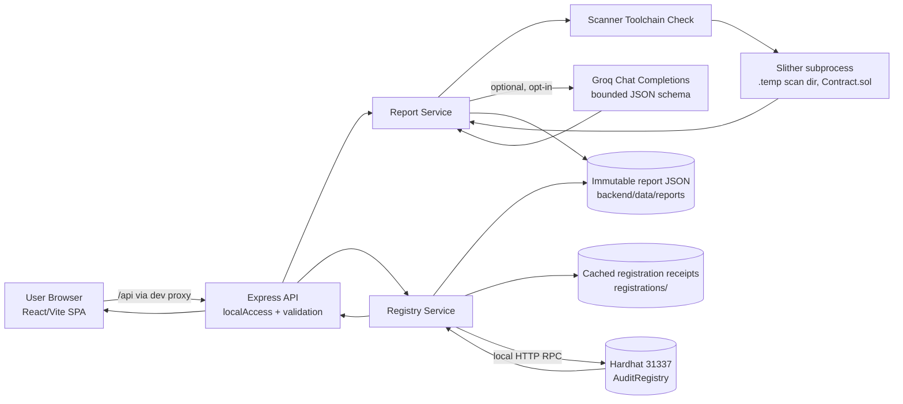

# SolidityGuard AI — Technical Repository Review Report

**Review date:** 2026-11-19 (environment date)  
**Repository (reviewed as-is):** `/home/rails/Downloads/SolidityGuard-AI (1)/SolidityGuard-AI`  
**Review type:** Static, evidence-driven repository-level review (no source modifications, no live exploitation, no production interaction, no secret values reproduced)

---

## Methodology and Verification Evidence

### Scope examined
- **Root/docs/config:** `README.md`, `package.json`, `.gitignore`, `.nvmrc`, `docs/screenshots/*`, `scripts/*`, `requirements-slither.txt`, `fixtures/*`
- **Frontend:** `frontend/package.json`, `frontend/vite.config.js`, `frontend/playwright.config.js`, `frontend/src/*`, `frontend/tests/*`
- **Backend:** `backend/package.json`, `backend/src/*`, `backend/tests/*`, `backend/.env.example`, presence/metadata checks for `backend/.env` and `backend/data/reports/*`
- **Blockchain:** `blockchain/package.json`, `blockchain/hardhat.config.cjs`, `blockchain/config.js`, `blockchain/contracts/AuditRegistry.sol`, `blockchain/scripts/deploy.js`, `blockchain/test/AuditRegistry.test.js`, `blockchain/deployments/localhost.json`, `blockchain/artifacts/contracts/AuditRegistry.sol/AuditRegistry.json`, `blockchain/cache/solidity-files-cache.json`

### Commands executed (read-only verification)
| Check | Command / method | Result (evidence) |
|---|---|---|
| Environment versions | `node --version`, `npm --version`, `python3 --version` | Node `v24.18.0`, npm `11.16.0`, Python `3.8.10` |
| Local RPC availability | `curl` JSON-RPC `eth_chainId` to `http://127.0.0.1:8545` | No local RPC responding at review time |
| Env key presence (values redacted) | Parsed `backend/.env` and `backend/.env.example` key names/non-empty-placeholder status only | `backend/.env`: `OPENAI_API_KEY` **NON-EMPTY (length 164, redacted)**, `GROQ_API_KEY` **NON-EMPTY (length 56, redacted)**, others set; `.env.example`: `GROQ_API_KEY` empty/placeholder |
| Toolchain presence | Checked `.venv/bin/python`, `.venv/bin/slither`, native solc, wrapper exec | `.venv/bin/python` missing target (`/home/rails/.pyenv/versions/3.12.2/bin/python3` not found); `slither` shebang `#!/home/rails/SolidityGuard-AI/.venv/bin/python` (stale path); `.venv/pyvenv.cfg` points to old path `/home/rails/SolidityGuard-AI/.venv`; native `.tools/solc-0.8.28 --version` = `0.8.28+commit.7893614a`; `scripts/solc.js` executable |
| Artifact vs deployment consistency | Compared `keccak256(artifact.deployedBytecode)` vs `deployments/localhost.json.runtimeCodeHash` via Node+ethers | **Mismatch:** artifact `0x474a711ddcb9175847d52d3f34d6f1ffa191130b441434b29bcdfb215ec97873` vs deployment `0xfb50ea49a658fedc1f9fd00f53104d6946b5691a6c0b5cde362aa60cfdb602e6` |
| Contract compilation (no artifact write) | `.tools/solc-0.8.28 --bin blockchain/contracts/AuditRegistry.sol` | Succeeded (bytecode produced, exit 0) |
| Backend tests | `npm test` | **49 tests, 36 pass, 13 fail**. Failures due to `SCANNER_TOOLCHAIN_UNAVAILABLE` (`backend/src/scanner-toolchain.js:18`, via `backend/src/services/scan.js:75`) caused by broken/stale `.venv` toolchain |
| Frontend production build | `npm run build` | **Passed** (Vite `v8.3.8`, 23 modules transformed, built in 127ms) |
| Blockchain + integration tests | Started temporary Hardhat node with caches redirected to `/tmp` (outside repo), then `npm run test:blockchain` | **11 tests, 4 pass, 7 fail**. 4 contract tests passed (`blockchain/test/AuditRegistry.test.js`); 7 integration tests failed during scan setup with same `SCANNER_TOOLCHAIN_UNAVAILABLE` (not contract/chain logic). Temporary node stopped after check |

### Limitations
- **Cannot verify:** live Groq API behavior, fresh clean-machine install, browser E2E in this run, successful end-to-end scan/register/verify flows in this environment (blocked by broken `.venv` scanner toolchain and no pre-aligned running deployment).
- **Not performed:** dependency/runtime exploit testing, production deployment, on-chain transactions with real funds, any repository modifications.
- Findings below distinguish confirmed issues, environment/reproducibility issues, design trade-offs, and unverified claims.

---

## 1. Executive Summary

| Item | Assessment | Evidence |
|---|---|---|
| **Project name and purpose** | `solidityguard-ai`: local Solidity review tool — scan single contract with Slither, optionally explain findings with Groq, save immutable SHA-256 JSON report, register/verify report hash on local Hardhat blockchain. States integrity ≠ contract security/authorship. | `README.md:1-8,88-101,136-160`; `package.json:2`; `backend/src/services/reports.js:58-99`; `backend/src/services/registry.js:78-140` |
| **Primary blockchain application category** | Hybrid Web2 + Web3 local audit/integrity-attestation tool (not DeFi/NFT/DAO/tokenization protocol) | `README.md:1-8`; `blockchain/contracts/AuditRegistry.sol:4-43`; `backend/src/services/registry.js:78-140` |
| **Main problem addressed** | Tamper-evident, locally verifiable audit-report provenance/integrity | `README.md:6-8,94-101,136-160`; `frontend/src/components/ReportActions.jsx:3-12,162-164` |
| **Technology stack** | Node 24/npm workspaces, React 19.3.1 + Vite 8.3.8, Express 5.3.0, ethers 6.17.0, Hardhat 2.29.2, Solidity 0.8.28, Slither 0.11.6, filesystem JSON storage, optional Groq Chat Completions | `package.json:4-12,29-36`; `.nvmrc` (`24.18.0`); `frontend/package.json`; `backend/package.json`; `blockchain/hardhat.config.cjs:16-21`; `blockchain/contracts/AuditRegistry.sol:2`; `requirements-slither.txt`; `backend/src/services/ai.js:1,102-163`; `backend/src/storage.js:8,33-104` |
| **Overall technical impression** | Thoughtful, security-aware local MVP with strong integrity/verification design; weakened by reproducibility, hygiene, and artifact-drift issues in this snapshot | Corroborated by code evidence and verification results below |
| **Biggest strengths** | Deterministic hashing + immutable atomic storage; server-side hash recomputation/no client-supplied registration hash; deployment/chain-state validation; clear unavailable-vs-mismatch and integrity-vs-security UX | `backend/src/hashing.js:5-36`; `backend/src/storage.js:16-21,33-59,61-84`; `backend/src/services/registry.js:34-52,79-81,85-87,126-139`; `frontend/src/api.js:20-27`; `frontend/src/components/ReportActions.jsx:3-12,82-100,162-164` |
| **Biggest weaknesses** | Plaintext non-placeholder API keys present in `backend/.env` (redacted); broken/stale `.venv` prevents scan-dependent tests/scanning; stale deployment runtime hash mismatches current artifact; no CI/auth/general rate limiting | Env key check (redacted); `.venv`/toolchain checks; hash comparison; `npm test` 13 failures; no `.github/workflows` observed in root listing |
| **Current maturity level** | Good local proof-of-concept/MVP with credible engineering depth in integrity and local Web3 workflow; **not** production-ready and not fully reproducible/runnable in this snapshot | Verified: build passed, but scan/integration flows blocked and config drift present |

---

## 2. Project Architecture and Technical Overview

### Technology stack (evidence-based)
| Layer | Details | Evidence |
|---|---|---|
| Frontend | React 19 SPA, Vite dev/build + proxy, plain JS/CSS, local hook-based state, no router/wallet/web3 libraries in browser | `frontend/src/main.jsx:1-6`; `frontend/src/App.jsx:1-30`; `frontend/src/api.js:35-40`; `frontend/vite.config.js:4-9` |
| Backend | Express 5 API, ESM, local host/origin guard, typed errors, filesystem persistence | `backend/src/app.js:1-30`; `backend/src/local-access.js:5-24`; `backend/src/routes.js:4-12`; `backend/src/errors.js:1-7`; `backend/src/storage.js:1-104` |
| Scanner | Slither subprocess with toolchain version checks, temp workspace, bounded timeout/output/result, restricted env | `backend/src/services/scan.js:1-102`; `backend/src/scanner-files.js:9-46`; `backend/src/scanner-toolchain.js:9-33` |
| AI (optional, opt-in) | Groq fixed endpoint, strict JSON schema, bounded findings/snippets/request/response, no tool calls, graceful unavailable/partial states | `backend/src/services/ai.js:1-163`; `backend/src/services/reports.js:87` |
| Blockchain | Solidity 0.8.28 `AuditRegistry`, Hardhat local chain 31337, ethers provider/contract usage, local signer index | `blockchain/contracts/AuditRegistry.sol:1-43`; `blockchain/hardhat.config.cjs:16-21`; `blockchain/config.js:5-28`; `backend/src/services/registry.js:1-142` |
| Data/storage | Immutable report JSON files + separate mutable registration receipts, deterministic canonical hashing | `backend/src/storage.js:8,33-104`; `backend/src/hashing.js:5-44` |

### Repository organization
| Area | Evidence |
|---|---|
| Frontend SPA, tests, Playwright config | `frontend/src/*`, `frontend/tests/app.spec.js`, `frontend/tests/server.js`, `frontend/playwright.config.js` |
| Backend API/services/persistence/tests and persisted report data | `backend/src/*`, `backend/tests/*`, `backend/data/reports/*.json`, `backend/data/reports/registrations/*.json` |
| Blockchain contract, config, scripts, tests, artifacts/cache/deployment record | `blockchain/contracts/AuditRegistry.sol`, `blockchain/config.js`, `blockchain/hardhat.config.cjs`, `blockchain/scripts/deploy.js`, `blockchain/test/AuditRegistry.test.js`, `blockchain/artifacts/*`, `blockchain/cache/solidity-files-cache.json`, `blockchain/deployments/localhost.json` |
| Fixtures and helper scripts | `fixtures/minimal.sol`, `fixtures/vulnerable.sol`, `fixtures/StakingVault.sol`; `scripts/scan.js`, `scripts/demo-blockchain.js`, `scripts/check-*.js`, `scripts/install-solc.sh`, `scripts/hardhat.sh`, `scripts/solc.js` |
| Docs and ignore rules | `docs/screenshots/desktop.png`, `docs/screenshots/mobile.png`; `.gitignore` excludes `.env*` (except example), `node_modules/`, `.venv/`, `.tools/`, `backend/data/`, artifacts/cache/build/test outputs (but several excluded categories are present in this workspace snapshot) |

### Key architectural boundaries and workflows
- **Browser does not hold wallet/signing logic:** UI calls backend API only (`frontend/src/api.js:36-39`, `frontend/src/App.jsx:265-284`); no wallet/RPC libraries found in frontend source.
- **Report creation flow:** validate input → serial scan guard → Slither scan/toolchain checks → normalize/summarize → optional AI → deterministic hash/integrity object → atomic immutable save (`backend/src/services/reports.js:11-27,56-103`; `backend/src/services/scan.js:72-102`; `backend/src/services/ai.js:102-163`; `backend/src/hashing.js:34-36`; `backend/src/storage.js:33-59`).
- **Registration flow:** reject client-supplied hash/body → load saved report and recompute hash → validate local deployment/chain/code/registrar/signer → submit/wait or recover confirmed on-chain evidence → best-effort receipt cache save (`backend/src/services/registry.js:34-52,63-76,79-117`).
- **Verification flow:** validate saved/uploaded package → recompute/compare hashes and declared integrity → query chain for computed and expected hash states → return `verified|mismatch|unregistered` or `unavailable` (`backend/src/services/registry.js:10-23,123-140`).
- **Data ownership:** on-chain mapping/event state is authoritative for registration existence (`blockchain/contracts/AuditRegistry.sol:11,18,33-42`); immutable report file is authoritative off-chain record (`backend/src/storage.js:16-21,61-71`); registration receipt file is cache with warnings on corruption/unreadability (`backend/src/storage.js:72-83,86-104`).

---

## 3. Feature and Functional Completeness Assessment

| Feature | Claimed behavior | Actual implementation | Status | Evidence |
|---|---|---|---|---|
| Local Slither scan of single `.sol` | Scan with pinned toolchain; fail on invalid/unsupported/import cases; no false “zero findings” on failure | Validation, toolchain check, bounded subprocess, temp files, result parsing implemented | **Partially Implemented / Cannot Verify in this env** | `README.md:103-112,129`; `backend/src/services/scan.js:12-102`; `backend/src/services/reports.js:11-27,63-71`; `npm test`: 49/36/13 with `SCANNER_TOOLCHAIN_UNAVAILABLE`; broken `.venv` (`slither` shebang/path to missing interpreter) |
| Optional Groq AI explanations | Opt-in, bounded external processing, structured output, partial/unavailable states, scanner severity unchanged | Fixed endpoint/config, strict schema, bounds/sanitization/filtering, opt-in only | **Implemented in code / Live provider not verified** | `README.md:78-87,162-188`; `backend/src/services/ai.js:1-163`; `backend/src/services/reports.js:87-97` |
| Immutable report + deterministic integrity hash | `{payload, integrity}` with SHA-256 `sg-json-v1`, payload-only hash, atomic publish, no full source persisted | Deterministic serializer/hash, integrity validation, atomic hard-link save, read-time recheck/freeze | **Fully Implemented (evidenced in code + partial tests)** | `README.md:136-155`; `backend/src/hashing.js:5-44`; `backend/src/storage.js:16-21,33-59,61-71,97-99`; hashing/storage-related backend tests passed in executed suite subset |
| Report retrieval/download and cached receipt handling | GET/download package; attach valid cached receipt or warning without invalidating intact payload | No-store GET, storage merges valid receipt/warnings; frontend re-fetches for download | **Implemented in code** | `README.md:121,150-152`; `backend/src/controllers.js:14-17`; `backend/src/storage.js:61-84`; `frontend/src/App.jsx:121-136` |
| On-chain registration | Register server-computed hash from saved report, wait for confirmation, recover duplicates/lost responses | Rejects client hash/body, recomputes hash, validates deployment/signer, tx wait + chain-evidence recovery, best-effort receipt save | **Partially Implemented / End-to-end not verified in this env** | `README.md:94-95,122,131-135,156-160`; `backend/src/services/registry.js:34-117`; `blockchain/test/AuditRegistry.test.js` 4/4 passed on temp node; integration register flows blocked by scan setup failure |
| Verification (saved/uploaded report) | Distinguish verified/mismatch/unregistered/unavailable against live chain state | Input/package validation, hash recomputation/comparison, on-chain checks for computed and expected hashes | **Implemented in code / End-to-end not verified in this env** | `README.md:95-100,123,125-126`; `backend/src/services/registry.js:10-23,123-140`; `frontend/src/api.js:20`; `frontend/src/components/ReportActions.jsx:3-12,82-86` |
| Local-only access model / no browser wallet | Local host/origin checks, local RPC/signer, no MetaMask | Middleware + loopback-only provider/RPC validation + backend signer index; frontend has no wallet code | **Implemented** | `README.md:60,270-272`; `backend/src/local-access.js:5-24`; `backend/src/app.js:11`; `blockchain/config.js:13-28`; `frontend/src/api.js:36-39` |
| Deployment/config consistency for registry use | Deploy records metadata; backend requires live matching deployment identity | Deploy/registry validation logic exists, but checked-in deployment record mismatches current artifact | **Broken or Incorrect (current snapshot)** | `README.md:158-159`; `blockchain/scripts/deploy.js` (logic reviewed in exploration); `backend/src/services/registry.js:39-47`; hash mismatch: artifact `0x474a...` vs deployment `0xfb50...` |
| Documented validation claims | README reports passing tests/build/audits/screenshots for prior date | Build passed now; partial tests now; screenshots present; browser/clean-install/live-AI not verified now | **Partially Verifiable / Historically claimed** | `README.md:203-248,279-280`; executed `npm run build` (pass), `npm test` (36/49), `test:blockchain` (4/11 pass; 7 scan-setup failures); `docs/screenshots/*.png` present |

---

## 4. Engineering Quality Assessment

### A. Architecture and design
- **Assessment:** Focused local architecture with sensible module/service boundaries and explicit trust boundaries.
- **Strengths:** Separation of API, report orchestration, scanner, AI, persistence, hashing, and registry concerns (`backend/src/services/*`, `backend/src/storage.js`, `backend/src/hashing.js`, `blockchain/contracts/AuditRegistry.sol`); client cannot supply registration hash (`backend/src/services/registry.js:79-81`); backend validates deployment identity before chain use (`backend/src/services/registry.js:34-52`).
- **Weaknesses:** Strong coupling to local filesystem/toolchain/Hardhat; checked-in generated/runtime artifacts and persisted data increase drift risk (`backend/data/reports/*`, `blockchain/artifacts/*`, `blockchain/cache/solidity-files-cache.json`, `blockchain/deployments/localhost.json`, `.venv`).
- **Evidence:** `package.json:5-9`; `backend/src/app.js:11-16`; repository tree; stale cache path observed in `blockchain/cache/solidity-files-cache.json` (per exploration) and stale deployment hash mismatch.
- **Improvements:** Enforce source-vs-generated artifact policy; add reproducible preflight/bootstrap and environment-specific deployment records.

### B. Frontend engineering
- **Assessment:** Solid small SPA with clear workflow/state handling for a backend-mediated Web3 flow.
- **Strengths:** Central async/error/busy handling (`frontend/src/App.jsx:32-42`); 90s timeout and special unavailable/timeout messaging (`frontend/src/api.js:2-4,20-32`); UI distinguishes verified/mismatch/unregistered/unavailable and warns timed-out registration may still confirm (`frontend/src/components/ReportActions.jsx:3-12,63-100`).
- **Weaknesses:** No TypeScript/type safety; no router; no explicit tx hash/block/reverted-state presentation; relies on backend as trust anchor for confirmation details.
- **Evidence:** `frontend/src/App.jsx:10-30,73-95,121-136,265-284`; `frontend/src/api.js:20-27,35-40`; `frontend/src/components/ReportActions.jsx:27-173`.
- **Improvements:** Typed API/report models, richer chain receipt/evidence display, explicit pending/reverted reconciliation states.

### C. Backend engineering
- **Assessment:** Strongest subsystem; defensive and explicit.
- **Strengths:** Local host/origin enforcement (`backend/src/local-access.js:7-22`); JSON/content-type/body limits (`backend/src/app.js:13-15`; `backend/src/controllers.js:3-5`); concurrency guards (`backend/src/services/reports.js:56-61,100-102`; `backend/src/services/registry.js:82-84,118-120`); bounded scanner/AI processing and sanitized errors (`backend/src/services/scan.js:12-68,72-75`; `backend/src/services/ai.js:57-77,131-147`).
- **Weaknesses:** No authentication/authorization beyond local-origin assumptions; no general rate limiting; minimal logging; single-user/local trust model.
- **Evidence:** `backend/src/app.js:11-26`; `backend/src/routes.js:7-10`; `backend/src/server.js:5-13`.
- **Improvements:** Structured logging/request IDs, optional auth for non-loopback contexts, rate limiting, health/readiness endpoint.

### D. Database and data management
- **Assessment:** Appropriate filesystem persistence for MVP with good integrity semantics.
- **Strengths:** Atomic immutable publish via temp+hard-link and fsync (`backend/src/storage.js:33-59`); integrity validated on write/read (`backend/src/storage.js:16-21,35-36,61-71`); separate mutable receipt cache with graceful warnings (`backend/src/storage.js:72-83,86-104`); strict deterministic canonicalization (`backend/src/hashing.js:5-28`).
- **Weaknesses:** No DB/index/history API; persisted sample/runtime reports committed/present in tree; no migration/versioning strategy beyond schema field.
- **Evidence:** `backend/src/storage.js:8,41,61-104`; `backend/data/reports/*` and `backend/data/reports/registrations/*` present.
- **Improvements:** Optional indexed store/report listing, cleanup/seeding strategy, storage repair tooling.

### E. Maintainability, performance, deployment, docs
- **Maintainability:** Readable modular JS code, but environment coupling and generated/data files reduce cleanliness (`backend/src/*`, `frontend/src/*`, checked-in artifacts/data).
- **Performance/scalability:** Adequate for bounded local use via size/time/output caps and serialized expensive operations (`backend/src/services/scan.js:9-10,43-68,72-75`; `backend/src/services/reports.js:56-61`; `backend/src/services/registry.js:82-84`; `frontend/src/api.js:2`).
- **Deployment/DevOps:** Local scripts and deploy validation exist (`package.json:14-27`; `blockchain/scripts/deploy.js`; `blockchain/config.js:13-28`), but no CI/CD/container/prod profile; stale local deployment metadata present.
- **Documentation/DX:** Detailed, candid README (`README.md:36-248,267-278`) but includes hardcoded path example (`README.md:38`) and historical validation claims not fully reproducible in this snapshot (`README.md:237-248`).

---

## 5. Smart Contract and Security Assessment

> **Note:** Static repository-level assessment only; **not** a formal independent security audit.

### Contract architecture and correctness
| Aspect | Assessment | Evidence |
|---|---|---|
| Contract | `AuditRegistry` (single contract, no inheritance/imports), minimal hash registry | `blockchain/contracts/AuditRegistry.sol:4-43` |
| State and access control | `authorizedRegistrar` immutable set in constructor (non-zero), registrar-only registration; permissionless reads | `AuditRegistry.sol:10,20-23,25-27,33-42` |
| Input/state checks | Rejects zero registrar/hash and duplicates; stores registrar + `block.timestamp`; emits indexed event | `AuditRegistry.sol:21,27-30,13-18` |
| External interactions | No ETH handling, no external calls, no delegatecall/selfdestruct/upgrade hooks | `AuditRegistry.sol:1-43` (entire contract) |

### Security findings and risks

| Finding | Location | Severity | Evidence | Potential impact | Recommendation |
|---|---|---|---|---|---|
| Single immutable registrar (centralized, non-rotatable authority) | `blockchain/contracts/AuditRegistry.sol:10,20-23,26` | **Medium (design trade-off)** | Registrar fixed at deployment; only this address can call `registerReport` | Key loss/compromise or operational rotation requires redeploy/new trust anchor | Document threat model; for broader use adopt multisig/role rotation with events/timelock |
| Stale deployment metadata vs current compiled artifact | `blockchain/deployments/localhost.json` vs `blockchain/artifacts/contracts/AuditRegistry.sol/AuditRegistry.json`; enforced by `backend/src/services/registry.js:39-47` | **Medium** | Computed runtime hash mismatch: artifact `0x474a711ddcb9175847d52d3f34d6f1ffa191130b441434b29bcdfb215ec97873` vs deployment `0xfb50ea49a658fedc1f9fd00f53104d6946b5691a6c0b5cde362aa60cfdb602e6` | Backend may report registry unavailable/misaligned until redeployed; operational confusion | Recompile/redeploy consistently, add automated artifact-vs-deployment-vs-chain check |
| Metadata uses block timestamp | `blockchain/contracts/AuditRegistry.sol:29-30` | **Low** | `block.timestamp` stored and emitted | Minor timing skew; not used for authorization/value transfer | Acceptable for metadata; document limitation |
| Opaque hash registration without on-chain domain binding | `blockchain/contracts/AuditRegistry.sol:25-31`; `backend/src/hashing.js:34-35` | **Low** | Contract accepts any non-zero unique `bytes32`; same hash could exist on another deployment/instance | Potential cross-environment ambiguity if consumers ignore registry identity | Always pin and present `chainId` + `registryAddress` (partly implemented: `registry.js:137-138`, UI states/flows) |

### Contract tests and execution evidence
- **Test coverage observed:** authorized registration/event/metadata, zero/duplicate/unauthorized reverts, public reads, zero-registrar deployment rejection (`blockchain/test/AuditRegistry.test.js:25-67`).
- **Executed:** `npm run test:blockchain` on temporary Hardhat node → **4 passed** contract tests, **7 failed** integration tests due to scanner toolchain setup (`SCANNER_TOOLCHAIN_UNAVAILABLE`), not due to contract behavior.
- **Gaps:** no fuzz/invariant/gas/fork/upgrade tests; limited direct getter/log-topic assertions.

---

## 6. Critical Findings (Prioritized)

| Priority | Finding | Location / code reference | Evidence | Why it matters | Recommendation |
|---|---|---|---|---|---|
| **P0 (Critical - security hygiene)** | Plaintext non-placeholder API keys present in workspace env file | `backend/.env` (present); `.gitignore` includes `.env*` but file exists in snapshot; guidance in `README.md:252-266`, `backend/.env.example:11` | Key-presence check (values redacted): `OPENAI_API_KEY` non-empty length 164, `GROQ_API_KEY` non-empty length 56 in `backend/.env`; `.env.example` placeholders | Accidental leakage risk via sharing/archive/copy; undermines security posture and credibility | Remove/rotate/revoke exposed keys, ensure excluded from all distributable artifacts, add secret scanning/pre-share checks |
| **P0 (Critical - functionality/reproducibility)** | Scanner toolchain broken/stale; core scan path not runnable/verifiable here | `.venv/bin/*`, `.venv/pyvenv.cfg`; scanner boundary `backend/src/scanner-toolchain.js:9-24`, `backend/src/services/scan.js:72-75` | `.venv` python target missing and slither shebang points to missing `/home/rails/SolidityGuard-AI/.venv/bin/python`; `npm test` 49/36/13 fails with `SCANNER_TOOLCHAIN_UNAVAILABLE`; 7 blockchain integration tests failed in scan setup for same reason | Real scanning and scan-dependent flows cannot be demonstrated or validated in this state | Rebuild pinned venv for supported Python in-place, run toolchain preflight, add deterministic bootstrap/CI check |
| **P0 (High/Critical - correctness & integration)** | Deployment metadata inconsistent with current contract artifact | `blockchain/deployments/localhost.json`, `blockchain/artifacts/contracts/AuditRegistry.sol/AuditRegistry.json`, `backend/src/services/registry.js:39-47` | Runtime hash mismatch (artifact `0x474a...` vs deployment `0xfb50...`); backend rejects stale/absent deployment evidence | Registry operations become unavailable/misleading even with a running chain; signals config drift | Recompile and redeploy from same state, commit consistent environment-specific records only as intended, add consistency `doctor`/CI check |
| **P1 (High)** | Access control limited to local-origin boundary; no auth/general rate limiting | `backend/src/local-access.js:5-24`; `backend/src/app.js:11`; `backend/src/routes.js:7-10`; single-flight only in `backend/src/services/reports.js:56-61`, `backend/src/services/registry.js:82-84` | Code inspection: no user/session/token auth or request-rate limiter; any caller satisfying host/origin constraints can invoke endpoints | Acceptable for stated local MVP but risky if assumptions change or exposed | Maintain strict loopback default, document threat model, add optional auth and rate limiting for broader use |
| **P1 (High)** | Registry authority is immutable and centralized | `blockchain/contracts/AuditRegistry.sol:10,20-23,26` | Single permanent registrar; no rotation/revocation/pause/multisig in contract | Operational/key-management rigidity and single-point trust/compromise impact | Treat as explicit design choice for local MVP; plan rotatable/multisig authority for expanded scope |
| **P1 (Medium-High)** | Reproducibility/hygiene and unverified historical claims | `README.md:237-248`; repository contents (`backend/data/*`, `blockchain/artifacts/*`, `blockchain/cache/*`, `blockchain/deployments/localhost.json`, `.venv`, `.tools` present) | This run: `npm run build` pass, `npm test` 36/49, blockchain 4/11 with scan-setup failures; browser/live-AI/clean-install not verified | Recruiters may question reliability and engineering discipline | Add CI evidence, separate generated/runtime/sample data, make validation claims continuously reproducible |
| **P2 (Medium)** | Limited blockchain transaction observability in UI | `frontend/src/components/ReportActions.jsx:63-94`; `frontend/src/api.js:24-27` | No tx hash/block/registrar evidence displayed; reverted/pending states not explicitly modeled; timeout warning relies on text | Harder reconciliation/debugging; weaker Web3 UX transparency | Return/display tx/chain/registry evidence and explicit tx lifecycle states |

### Application security beyond smart contracts (summary)
| Area | Finding | Severity | Evidence |
|---|---|---|---|
| Secrets/config hygiene | Plaintext API keys present in `backend/.env` (redacted) | **High** | Non-empty key lengths verified; file present despite `.env*` ignore policy |
| Frontend | No dangerous HTML sinks or stored browser secrets observed in reviewed source | **Low / positive control** | React text rendering patterns in `frontend/src/components/*`; no wallet/auth token storage in `frontend/src/api.js` (per static review) |
| Backend/API | Local-origin guard, strict validation/bounds, but no auth/general rate limiting | **Medium** | `backend/src/local-access.js:5-24`, `backend/src/app.js:13-15`, `backend/src/controllers.js:3-5`, route exposure in `backend/src/routes.js:7-10` |
| Scanner execution | Bounded subprocess with restricted env, not a hostile multi-tenant sandbox | **Medium (contextual)** | `backend/src/services/scan.js:12-68,72-87`; `README.md:276-277` acknowledges limits |
| Blockchain/provider handling | Loopback-only RPC validation and deployment/code/receipt checks | **Low / positive control** | `blockchain/config.js:13-22,24-28`; `backend/src/services/registry.js:34-52` |

---

## 7. Recruiter and Technical Interviewer Assessment

### What makes the project stand out
- **Meaningful integrity design:** deterministic canonical hashing and immutable atomic report persistence with read-time integrity checks (`backend/src/hashing.js:5-36`; `backend/src/storage.js:16-21,33-59,61-71`).
- **Correct trust boundary for registration/verification:** backend recomputes hashes from stored/submitted payloads and rejects client-supplied registration metadata (`backend/src/services/registry.js:10-23,79-81,85-87,126-139`).
- **Non-superficial local blockchain integration:** deployment/runtime-code/receipt/registrar validation and confirmation recovery against `AuditRegistry` (`backend/src/services/registry.js:34-52,63-76,98-108`; `blockchain/contracts/AuditRegistry.sol:20-42`).
- **Defensive engineering and product honesty:** bounded scan/AI handling, graceful unavailable/partial states, and clear “integrity ≠ security/authorship” messaging (`backend/src/services/scan.js:12-68`; `backend/src/services/ai.js:57-77,112-156`; `README.md:6-8`; `frontend/src/components/ReportActions.jsx:162-164`).

### What weakens its portfolio value
- **Reproducibility and hygiene issues:** broken/stale `.venv`, stale deployment hash mismatch, plaintext API keys present in `backend/.env` (redacted), and checked-in generated/runtime artifacts/data.
- **Validation confidence gap:** scan-dependent tests failed in this environment; browser/live-AI/clean-install not independently verified now.
- **Limited Web3 depth:** local Hardhat only, backend-mediated signing, no wallet UX, no indexing/finality/reorg strategy beyond simple local assumptions, minimal contract feature set.

### Skills demonstrated (evidence-based)
| Skill area | Evidence |
|---|---|
| Full-stack development | React/Vite SPA + Express API + filesystem persistence + scripts (`frontend/src/*`, `backend/src/*`, `package.json`) |
| Blockchain/Web3 integration | ethers provider/contract calls, local chain/deployment validation, tx confirmation/recovery (`blockchain/config.js`, `backend/src/services/registry.js`, `blockchain/contracts/AuditRegistry.sol`) |
| Smart contract development | Simple correct Solidity registry with targeted tests (`blockchain/contracts/AuditRegistry.sol`, `blockchain/test/AuditRegistry.test.js`) |
| Security awareness | Input/content-type/size validation, local-origin controls, subprocess/AI bounds, chain-evidence checks (`backend/src/local-access.js`, `backend/src/app.js`, `backend/src/services/scan.js`, `backend/src/services/ai.js`, `backend/src/services/registry.js`) — offset by secret-hygiene lapse in workspace |
| Testing discipline (intent) | Unit/integration/contract/browser test suites present (`backend/tests/*`, `blockchain/test/AuditRegistry.test.js`, `frontend/tests/app.spec.js`), though not fully green in this snapshot |

### Likely interview questions (repository-specific)
1. Why use deterministic `sg-json-v1` canonicalization and hash only `payload` (`backend/src/hashing.js:5-36`, `backend/src/storage.js:97-99`)? What JSON ambiguities does this avoid?
2. Why publish immutable reports via temp file + fsync + hard-link in `saveReport` (`backend/src/storage.js:33-59`) instead of rename?
3. Why must `/register` reject client-supplied hashes/body and recompute from stored payload (`backend/src/services/registry.js:79-81,85-87`)?
4. Walk through `withRegistry`’s deployment authenticity checks (`backend/src/services/registry.js:34-52`). How do runtime code hash and deployment receipt checks detect resets/stale config?
5. How does registration recover from duplicate/lost-RPC-response cases (`backend/src/services/registry.js:63-76,94-108`), and why prefer on-chain evidence?
6. How is `verified` vs `mismatch` vs `unregistered` vs `unavailable` determined (`backend/src/services/registry.js:123-140`, `frontend/src/components/ReportActions.jsx:3-12,82-86`)?
7. What are the trust/liveness trade-offs of a single immutable `authorizedRegistrar` in `AuditRegistry` (`blockchain/contracts/AuditRegistry.sol:10,20-31`)?
8. Why is `block.timestamp` acceptable for this contract’s metadata (`blockchain/contracts/AuditRegistry.sol:29-30`)?
9. What protections bound untrusted Solidity handling in the scanner pipeline (`backend/src/services/scan.js:12-68,72-87`), and why is this not a hostile-upload sandbox (`README.md:276-277`)?
10. What does `localAccess` protect against and what does it not (`backend/src/local-access.js:5-24`)?
11. How are AI prompts/responses bounded and validated to reduce prompt-injection/data-shape risk (`backend/src/services/ai.js:6-77,112-156`)?
12. Why include AI results in the immutable payload before hashing (`backend/src/services/reports.js:87-99`)?
13. What are the UX/trust implications of backend-mediated registration with no browser wallet (`frontend/src/api.js:38-39`, `frontend/src/App.jsx:265-284`)?
14. How should clients reconcile a timed-out registration given `frontend/src/api.js:24-27` and backend recovery logic?
15. Given the observed `.venv` breakage and artifact/deployment hash mismatch, how would you make setup and CI deterministic?

### Interview risk areas
- Explaining and remediating secret-hygiene lapse (`backend/.env` keys present, redacted in this report).
- Demonstrating a clean, reproducible end-to-end run (scanner toolchain and deployment alignment currently problematic).
- Defending blockchain depth choices (minimal contract, local-only chain, centralized registrar, no wallet/finality/indexing).

---

## 8. Recommended Improvement Roadmap

### P0 — Must Fix
| Problem | Proposed improvement | Expected benefit | Priority | Effort | Evidence |
|---|---|---|---|---|---|
| Exposed credentials in workspace | Remove `backend/.env` from shareable state, rotate/revoke affected keys, add secret scanning and pre-share/archive checks | Eliminates leakage risk; restores baseline security credibility | P0 | Small | `backend/.env` contains non-empty `OPENAI_API_KEY`/`GROQ_API_KEY` (lengths verified, values redacted) |
| Broken/stale scanner toolchain | Recreate pinned Python venv in correct path, verify Slither/solc via preflight, make bootstrap deterministic | Restores core scan functionality and test reproducibility | P0 | Medium | Stale shebang/path and missing interpreter target; `npm test` 13 failures `SCANNER_TOOLCHAIN_UNAVAILABLE` |
| Deployment/artifact drift | Rebuild artifacts and redeploy from same revision; add `doctor` check for artifact/deployment/live-code hash consistency | Prevents registry unavailability/misalignment and config confusion | P0 | Small | Runtime hash mismatch artifact `0x474a...` vs deployment `0xfb50...`; `registry.js:39-47` enforces match |

### P1 — High Value
| Problem | Proposed improvement | Expected benefit | Priority | Effort | Evidence |
|---|---|---|---|---|---|
| No CI / limited reproducible validation | Add CI for build, backend tests, contract tests, and supported-env toolchain/bootstrap smoke checks | Continuous proof of correctness and regression prevention | P1 | Medium | No `.github/workflows` observed; partial local results vs README claims (`README.md:237-248`) |
| Local-only boundary without auth/rate limiting | Keep loopback defaults; add optional auth token, request rate limiting, structured audit logs if exposure model changes | Defense-in-depth and safer operations | P1 | Medium | `backend/src/local-access.js:5-24`, no auth middleware/rate limiter in routes/app |
| Centralized immutable registrar | Document threat model; consider multisig/registrar rotation or explicit migration path | Better key management and operational resilience | P1 | Medium | `blockchain/contracts/AuditRegistry.sol:10,20-23,26` |
| Limited chain observability in UX/API | Surface tx hash/block/chain/registry address and explicit pending/reverted states | Easier reconciliation and clearer Web3 UX | P1 | Small | `frontend/src/api.js:24-27`; `frontend/src/components/ReportActions.jsx:63-94` |
| Repository hygiene | Separate/remove generated artifacts, caches, and sample runtime data from reviewable source snapshots; provide seed/reset scripts | Cleaner reproducibility and reviewer confidence | P1 | Small | `backend/data/reports/*`, `blockchain/artifacts/*`, `blockchain/cache/*`, `blockchain/deployments/localhost.json`, `.venv/.tools` present |

### P2 — Nice to Have
| Problem | Proposed improvement | Expected benefit | Priority | Effort | Evidence |
|---|---|---|---|---|---|
| No report history/discovery UX | Add list/search endpoint and UI over stored reports | Better demoability and usability | P2 | Medium | Storage/API support lookup by known ID only (`backend/src/storage.js:61-66`, `backend/src/routes.js:7-10`) |
| JS-only, implicit schemas | Introduce TypeScript/shared request-response schemas | Fewer runtime shape errors, easier maintenance | P2 | Large | `frontend/src/*.jsx/js`, `backend/src/*.js`, no TS config observed |
| Limited contract/protocol depth | If scope expands, add role management/events/multi-env deployment docs (without overengineering current MVP) | Clearer evolution path and stronger Web3 signal | P2 | Medium | Minimal `AuditRegistry` feature set (`AuditRegistry.sol:4-43`) |
| Test gaps | Add fuzz/invariant/property cases for registry/integrity and more negative integration scenarios in CI | Higher confidence in edge cases | P2 | Medium | Current contract tests narrow (`blockchain/test/AuditRegistry.test.js:25-67`); snapshot not fully green |

---

## 9. Final Technical Scores

| Category | Score / 10 | Reasoning | Key evidence |
|---|---:|---|---|
| Overall Engineering Quality | **7.2** | Strong integrity/defensive design, but reproducibility and hygiene issues are significant | `hashing.js`, `storage.js`, `registry.js`; broken `.venv`; stale deployment hash; `backend/.env` keys present (redacted) |
| Architecture and Design | **7.8** | Clear boundaries and trust model for local MVP; coupled to local environment/artifacts | `app.js`, `services/*`, `storage.js`, `registry.js`, `AuditRegistry.sol` |
| Frontend Engineering | **7.0** | Good state/error/status handling and no-wallet simplicity; no TS and limited tx observability | `frontend/src/App.jsx`, `frontend/src/api.js`, `frontend/src/components/ReportActions.jsx` |
| Backend Engineering | **8.0** | Best area: validation, bounds, local controls, careful orchestration | `backend/src/app.js`, `local-access.js`, `services/scan.js`, `services/ai.js`, `services/registry.js` |
| Database Design | **N/A** | No database; filesystem persistence by design | `backend/src/storage.js:8` |
| Smart Contract Engineering | **6.8** | Correct, minimal, fit-for-purpose contract; narrow scope and centralized authority | `blockchain/contracts/AuditRegistry.sol` |
| Smart Contract Security | **7.0** | No confirmed critical/high logic flaw found; centralization and deployment drift are main concerns | `AuditRegistry.sol`; runtime hash mismatch; `registry.js:39-47` |
| Blockchain Integration | **7.6** | Meaningful deployment/receipt/chain-evidence checks and recovery; local-only depth | `blockchain/config.js`, `registry.js:34-76,98-108` |
| Business Logic and Functional Completeness | **7.4** | Core workflow well designed; not fully demonstrable in this snapshot | `reports.js`, `registry.js`, `README.md`; partial test/build results |
| Testing and Reliability | **6.5** | Good test breadth exists, but snapshot not fully green/reproducible and no CI evidence | `npm test` 36/49, `test:blockchain` 4/11 pass (scan-setup failures), `npm run build` pass |
| Performance and Scalability | **6.8** | Appropriate bounds for local single-user MVP; not built for scale | `scan.js` caps/timeouts, serialized operations in `reports.js`/`registry.js` |
| Documentation and Developer Experience | **7.5** | Detailed and candid docs; some reproducibility/path/hygiene mismatches | `README.md`, `backend/.env.example`, observed environment drift |
| Recruiter Appeal | **7.3** | Real engineering judgment visible, but hygiene/reproducibility issues raise caution | Strengths in integrity/verification vs secret/toolchain/deployment issues |
| Overall Portfolio Readiness | **7.0** | Credible local MVP; needs cleanup and reproducible demo before high-stakes presentation | Aggregate of verified strengths/issues above |

**Portfolio Readiness Classification:** **Good** — demonstrates credible practical engineering skills and a reasonably complete local application, but not “Excellent” due to reproducibility, deployment consistency, and security-hygiene issues.

---

## 10. Final Verdict

1. **Would you shortlist this repository for a technical interview?** **Yes, with reservations.** Evidence of thoughtful integrity and backend/blockchain integration is strong (`hashing.js`, `storage.js`, `registry.js`, `AuditRegistry.sol`), but I would probe reproducibility and secret hygiene.
2. **Does it demonstrate the skills expected from a competent Full-Stack Blockchain Engineer?** **Partially to yes (local MVP scope).** Shows competent full-stack work and meaningful on-chain attestation; limited protocol/wallet/multi-network depth.
3. **Does it demonstrate genuine smart contract engineering capability?** **Basic-to-solid for a narrow use case.** Contract is correct and tested for purpose, but intentionally simple (`AuditRegistry.sol`, 4 passing contract tests).
4. **Is the blockchain integration meaningful or mostly superficial?** **Meaningful.** Chain state is validated and used as verification evidence, not decoration (`registry.js:34-76,98-108,123-139`).
5. **Is the application sufficiently complete to be demonstrated?** **Conceptually yes; this snapshot is not reliably demo-ready as-is.** Build passed, but scan toolchain is broken and deployment metadata is stale/mismatched (verified).
6. **Three most important improvements:** (1) remove/rotate exposed keys and enforce secret hygiene; (2) repair bootstrap/toolchain and make tests/CI reproducibly green; (3) align artifacts/deployment with automated consistency checks and improve tx/chain observability in UX.
7. **Single biggest weakness negatively influencing recruiter impression:** **Reproducibility and security hygiene in this snapshot** (plaintext API keys present in `backend/.env`, redacted; broken `.venv`; stale deployment hash mismatch).
8. **Engineering level demonstrated:** **Intermediate** (with notable strengths in integrity-oriented design).
9. **Priorities before presenting in a technical interview:** produce a clean reproducible demo (fresh env, aligned deploy/artifacts, passing scan/register/verify flow), remove secrets, prepare CI/test evidence, and be ready to defend threat-model trade-offs (local trust, immutable registrar, non-sandboxed scanner).

**Final assessment:** SolidityGuard AI is a **compelling local MVP** with real engineering substance in report integrity, defensive backend design, and honest verification semantics. However, in the exact reviewed snapshot, a senior interviewer would likely distinguish the project’s strong design intent from its current operational readiness due to verifiable environment drift, broken scan tooling, and secret-hygiene issues.
